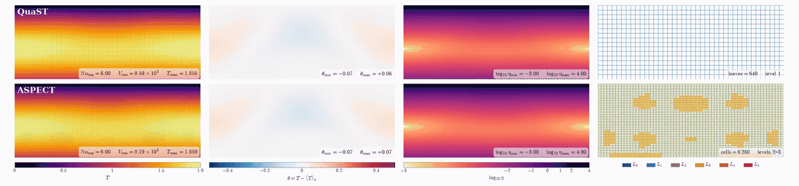

# QuaST

<p align="center">
  <b>A spectral-element solver for two-dimensional mantle convection</b><br>
  adaptively refined quadtree · matrix-free multigrid Stokes solve
</p>

<p align="right"><a href="README.zh.md">中文</a></p>

QuaST solves the incompressible Boussinesq or anelastic Stokes and energy equations for thermal convection in a two-dimensional Cartesian box. Velocity and pressure are Taylor–Hood elements of polynomial degree `p` and `p - 1` on Gauss–Legendre–Lobatto nodes. The mesh is a 2:1-balanced quadtree that adapts to the solution, and the temperature is advanced with BDF2. The flow is a quasi-static Picard iteration: each step solves the Stokes saddle, then advances the energy equation with that velocity. The saddle is solved by sparse direct factorization or by matrix-free geometric multigrid, and `linear = :auto` chooses between the two from the saddle size and the viscosity contrast.



The same realistic case run by QuaST (top) and by ASPECT (bottom), from the same initial state: temperature, its anomaly about the horizontal mean, viscosity on a logarithmic color scale, and the mesh colored by refinement level.

## What it does

- Carries composite diffusion–dislocation creep, depth-dependent Drucker–Prager yielding, strain weakening, phase transitions with latent heat, internal heating, and Maxwell viscoelasticity.
- Sets the four walls per wall. A wall is free slip, no slip with an optional prescribed wall velocity, or open with no Dirichlet condition on either component. A closed wall has a Dirichlet normal velocity; a free or open wall carries a prescribed tangential traction, and an open wall a prescribed normal traction. The pressure gauge is derived from the configuration, and an ill-posed configuration is refused instead of solved.
- Refines the quadtree with a gradient-jump indicator over the temperature, the velocity or both, and stabilizes the energy step with entropy viscosity. A run restarts bitwise from an HDF5 checkpoint.
- Ships the realistic 2.5 x 1 production card, the Blankenbach steady benchmarks and the blob regression, and two [regional cases](docs/en/examples.md): a plane channel with an exact Poiseuille solution and a subduction-style box with a far-field inflow and an open trench-side outflow.

## What it does not do

The Scope section of the [validation page](docs/en/validation.md#scope) lists what the solver does not do.

## Three commands to a first result

```bash
git clone git@github.com:edwardaud/QuaST.git && cd QuaST
julia --project=. -e 'using Pkg; Pkg.instantiate()'
CASE_OUT=/tmp/quast_smoke julia --project=. examples/case_realistic_2d.jl smoke
```

The second command takes five to ten minutes on a clean depot and under 2 GB of disk. The third advances ten steps of the shipped realistic card; the first run takes about two minutes, almost all of it compilation. It adapts the mesh at steps 5 and 10, writes `history.csv` and `frames/` under `CASE_OUT`, writes no checkpoint, and ends with a `[case] DONE mode=smoke steps=10` line. **Set `CASE_OUT` on every run:** without it the card writes into `out_julia/case_realistic`, which may hold an earlier run. Julia 1.12 is the version the commands were checked on; `Project.toml` admits 1.10 and later.

Ten steps are a smoke test, not a result. The files a run writes, the first settings to change and the failures a new user meets are in the [quick start](docs/en/quickstart.md).

## Verification

| Check | Result | Recorded in |
|---|---|---|
| Blankenbach et al. (1989) case 1a at level 5, steady state: `Nu` against the published 4.884409 | **+0.08%** | [Validation](docs/en/validation.md#steady-benchmarks) |
| The same state imported from ASPECT and advanced by both codes: `Nu_bot` against ASPECT | **+0.003%** | [Validation](docs/en/validation.md#cross-code-comparisons) |
| The per-wall boundary conditions against exact solutions: traction-driven Couette, an open wall with a normal traction, channel Poiseuille, and the regional `validate` mode | traction Couette `u` error **7.6e-15** and `p` **2.6e-12**; channel Poiseuille `u` **9.9e-15**; **13 of 13** regional checks pass | [Validation](docs/en/validation.md#boundary-conditions) |
| The gate suite, 184 files | **133 716** assertions: 133 714 passed, 0 failed, 2 broken entries that wait for checkpoints the repository does not ship | [test/README.md](test/README.md) |

The validation page gives the convergence behind the Blankenbach number, the boundary-condition checks, the two Nusselt conventions, the viscoelastic checks and the limit of the evidence.

## Documentation

Start at the [documentation map](docs/README.md), which lists every page and the reading order. For a first run read the [quick start](docs/en/quickstart.md); for a case to copy, the [examples](docs/en/examples.md); for the equations and every parameter, the [guide](docs/en/guide.md). The [validation page](docs/en/validation.md) carries the evidence, the [FAQ](docs/en/faq.md) the common changes, and the [architecture page](docs/architecture.md) the code layout.

## License

MIT, see [LICENSE](LICENSE).

**Next:** the [documentation map](docs/README.md) gives the reading order; start with the [quick start](docs/en/quickstart.md).
