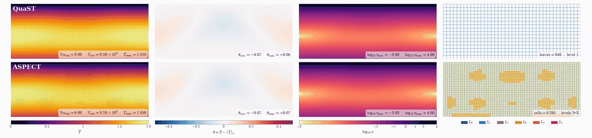

# QuaST

<p align="center">
  <b>二维地幔对流谱元求解器</b><br>
  自适应四叉树网格 · 无矩阵多重网格 Stokes 求解
</p>

<p align="right"><a href="README.md">English</a></p>

QuaST 求解二维直角盒子内地幔对流的不可压 Boussinesq 或滞弹性 Stokes 方程与能量方程。速度取 `p` 次 Taylor–Hood 单元，压力取 `p - 1` 次，节点为 Gauss–Legendre–Lobatto 点。网格是保持 2:1 平衡的四叉树，随解自适应；温度用 BDF2 推进。Stokes 鞍点有两条路径：稀疏直接分解，或无矩阵几何多重网格；`linear = :auto` 按鞍点规模与黏度对比选择。物性部分覆盖扩散–位错复合流变、随深度变化的 Drucker–Prager 屈服、应变弱化、带潜热的相变、内部加热，以及 Maxwell 黏弹性。



图：同一个真实算例，上排 QuaST，下排 ASPECT，从同一初值出发。四列依次为温度、相对水平平均的温度异常、对数色标下的黏度，以及按加密层级着色的网格。

## 能做什么，不能做什么

| 能做 | 不能做 |
|---|---|
| 在二维直角盒子内求解；四壁可分别设为自由滑移或无滑移，并可给出给定的壁面速度 | 做三维，或做球壳 |
| 支持 Boussinesq 与滞弹性两种质量守恒形式，以及 TALA/ALA 参考态 | 模拟环型运动、板块边界、磁场或自由表面 |
| 四叉树自适应，误差指示量可取温度、速度或两者；网格保持 2:1 平衡，能量步用熵黏性稳定 | 把完全弹性作为独立流变；本版本唯一的弹性行为是 Maxwell 黏弹性 |
| 携带扩散–位错复合流变、随深度变化的 Drucker–Prager 屈服、应变弱化、带潜热的相变与内部加热 | 移动顶面：Maxwell 应力历史不是自由表面，不产生地形 |
| 用稀疏直接分解或无矩阵几何多重网格求解鞍点（`linear = :auto` 选择），并从 HDF5 检查点逐位重启 | 使用非结构网格：网格是方形叶子的四叉树 |

## 三条命令跑出第一个结果

```bash
git clone git@github.com:edwardaud/QuaST.git && cd QuaST
julia --project=. -e 'using Pkg; Pkg.instantiate()'
CASE_OUT=/tmp/quast_smoke julia --project=. examples/case_realistic_2d.jl smoke
```

第二条命令在干净的环境里要五到十分钟，占用不到 2 GB 磁盘。第三条跑真实算例的前 10 步，首次约两分钟，几乎全是编译：第 5 步和第 10 步各做一次网格自适应，在 `CASE_OUT` 下写出 `history.csv` 和 `frames/`，不写检查点，结束时打印 `[case] DONE mode=smoke steps=10`。**每次都要设 `CASE_OUT`**：不设时结果写进 `out_julia/case_realistic`，那里可能放着上一次的预积分。命令按 Julia 1.12 核对；`Project.toml` 允许 1.10 及以后。

这十步只是冒烟测试，不是结果。一次运行会产出哪些文件、最先要改哪几项设置、出错时怎么处理，见[快速开始](docs/zh/quickstart.md)。

## 验证

| 对照 | 结果 | 记录在 |
|---|---|---|
| Blankenbach 等（1989）算例 1a，第 5 级加密下的稳态：`Nu` 对发表值 4.884409 | **+0.08%** | [验证](docs/zh/validation.md) |
| 同一状态由 ASPECT 导入、两程序各自推进：`Nu_bot` 对 ASPECT | **+0.003%** | [验证](docs/zh/validation.md) |
| 自动化测试套件 | **133 600** 条断言通过、0 条失败，另有 2 条 broken（等待本仓库未附带的检查点） | [CONTRIBUTING.md](CONTRIBUTING.md) |

Blankenbach 数值背后的收敛过程、Tosi 极限环结果、黏弹性检查、Nusselt 数的两种约定，以及证据的边界，都在验证页。套件用 `julia --project=. test/runtests.jl` 运行。

## 文档

先从[文档索引](docs/README.md)看全部文档与阅读顺序。第一次运行看[快速开始](docs/zh/quickstart.md)；要照抄算例看[算例](docs/zh/examples.md)；要查方法、全部可调项与输出格式看[用户指南](docs/zh/guide.md)。要核对数值看[验证](docs/zh/validation.md)，常改的地方看[常见问题](docs/zh/faq.md)，代码怎么组织看[代码结构](docs/architecture.md)。

## 许可

MIT，见 [LICENSE](LICENSE)。

**下一步：** 先看[文档索引](docs/README.md)的阅读顺序，再从[快速开始](docs/zh/quickstart.md)运行第一条命令。
