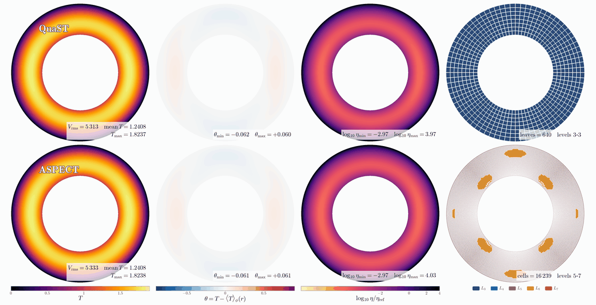

# QuaST

<p align="center">
  <b>二维地幔对流谱元求解器</b><br>
  自适应四叉树网格 · 无矩阵多重网格 Stokes 求解
</p>

<p align="right"><a href="README.md">English</a></p>

QuaST 在二维直角盒子里求解地幔对流：不可压 Boussinesq 或滞弹性的 Stokes 方程，加一个能量方程。速度和压力取 Taylor–Hood 单元，阶数分别是 `p` 与 `p - 1`，节点用 Gauss–Legendre–Lobatto 点。网格是随解加密的四叉树，始终保持 2:1 平衡；温度用 BDF2 推进。每步先做一次准静态流场求解，流场用 Picard 迭代，再把速度交给能量方程。Stokes 鞍点走稀疏直接分解，或走无矩阵几何多重网格；`linear = :auto` 按鞍点规模与黏度对比自动选路。同一套离散还通过几何/映射层跑在第二种几何上：二维极坐标圆环——闭合周期环，或带对称切割的楔形——映射后的度量贯穿装配、诊断与检查点标识。


图：同一个真实算例，上排 QuaST，下排 ASPECT，从同一初值出发。四列依次为温度、相对水平平均的温度异常、对数色标下的黏度，以及按加密层级着色的网格。



图：[真实 2.5 x 1 地幔算例卡](examples/case_realistic_2d.jl) 在闭合二维圆环上的版本，上排 QuaST、下排 ASPECT，从同一个解析初值出发，各自使用自己的自适应网格，时间取羽流生长最活跃的 `t_nd = 1e-6 .. 1.2e-4`。四列依次为总温度、相对每个半径上角向平均的温度异常、复合扩散–位错流变的对数黏度 `log10(eta/eta_ref)`（幂律色标，色条标注真实范围，深色 = 硬 = 冷），以及按树层级着色的自适应网格。算例卡取 `H = 10`、复合标定点处 `Ra = 1e5`（QuaST 最终实测内部 Rayleigh 数为 `3.47e7`），含两个相变与逐相潜热，自由滑移圆环。QuaST 使用平衡 AMR，指标为归一化的温度+速度跳变（`both`），`refine_frac = 0.3`，25 000 叶预算（5/0.1 壁面规则）与直接解；这是演示设置，不是盒子卡原本的 `theta`/0.2：在圆环上，`theta`/0.2 的 Dörfler 集合曾连续约 1.2 s 完全落在 L7 叶上，既不能细化也不能粗化，该版本只保留在仓库历史里。ASPECT 逐字使用盒子片段的那七行 AMR 设置，在圆环上稳定。`H = 10` 时逐壁 Nusselt 归一化没有定义（含 H 的基态通量在内壁反号），因此面板显示 `V_rms`、`mean T` 与 `T_max`。两侧的离散、指标与自适应策略不同，场和网格历史本来就不同：这是两种代码上自适应路径的演示，不是精度声明。图的 [JSON sidecar](docs/assets/quast_vs_aspect_annulus_demo.json) 记录算例卡、两侧 AMR 设置、色标以及逐帧时刻与偏移。区域是圆盘，所以面板为正方形；面板上方不画任何内容。

## 能做什么

- 物性覆盖扩散–位错复合蠕变、随深度变化的 Drucker–Prager 屈服、应变弱化、带潜热的相变、内部加热与 Maxwell 黏弹性。
- 边界条件逐壁设置。每面壁可以是自由滑移、无滑移（可附一条给定的壁面速度），或开壁（两个分量都没有 Dirichlet 条件）。闭壁的法向速度是 Dirichlet 条件；自由壁与开壁可给切向牵引，开壁还可给法向牵引。压力基准由配置推导，不适定的配置直接拒绝，不去解一个奇异的问题。
- 四叉树按温度、速度或两者的梯度跳变指示量加密，能量步用熵黏性稳定。运行可以从 HDF5 检查点逐位重启。
- 附带 2.5 x 1 的真实生产算例卡、Blankenbach 与二维圆环两个已发表基准、blob 回归，以及两个[区域算例](docs/zh/examples.md)：平面通道有精确的 Poiseuille 解，俯冲型算例用远场入流与开壁出流。

## 不能做什么

求解器不能做什么，见[验证](docs/zh/validation.md#这个求解器不能做什么)页末尾的清单。

## 三条命令跑出第一个结果

```bash
git clone git@github.com:edwardaud/QuaST.git && cd QuaST
julia --project=. -e 'using Pkg; Pkg.instantiate()'
CASE_OUT=/tmp/quast_smoke julia --project=. examples/case_realistic_2d.jl smoke
```

第二条命令在干净环境里要五到十分钟，占用不到 2 GB 磁盘。第三条跑真实算例的前 10 步，首次约两分钟，几乎全是编译；第 5 步和第 10 步各做一次网格自适应，在 `CASE_OUT` 下写出 `history.csv` 与 `frames/`，不写检查点，结束时打印 `[case] DONE mode=smoke steps=10`。**每次运行都要设 `CASE_OUT`**：不设时结果写进 `out_julia/case_realistic`，那里可能放着更早的一次运行。命令按 Julia 1.12 核对，`Project.toml` 允许 1.10 及以后。

这十步只是冒烟测试，不是结果。一次运行会写出哪些文件、最先要改哪几项设置、出错时怎么处理，见[快速开始](docs/zh/quickstart.md)。

## 验证

| 对照 | 结果 | 记录在 |
|---|---|---|
| Blankenbach 等（1989）算例 1a，第 5 级加密下的稳态：`Nu` 对发表值 4.884409 | **+0.08%**（自身 GCI 0.083 %） | [验证](docs/zh/validation.md#稳态基准) · [记录](benchmarks/results/blankenbach1a_nu-L3toL5_steady.md) |
| 二维圆环基准，ASPECT 级 128 x 1536 分辨率：`Nu_T` 对 ASPECT 的 9.548 | **+0.20%**，是该运行自身 0.462 % GCI 的 0.44 倍——在不确定度内一致，不是 0.20 % 的精度声明 | [验证](docs/zh/validation.md#二维圆环) · [记录](benchmarks/results/annulus_nu-t_128x1536_rung4.md) |
| 同一状态由 ASPECT 导入、两程序各自推进：`Nu_bot` 对 ASPECT | **+0.003%** | [验证](docs/zh/validation.md#跨代码对照) |
| 逐壁边界条件对精确解：切向牵引 Couette、开壁法向牵引、槽道 Poiseuille，以及区域算例的 `validate` | 牵引 Couette 速度误差 **7.6e-15**、压力 **2.6e-12**；槽道 Poiseuille 速度 **9.9e-15**；区域验证 **13 项全部通过** | [验证](docs/zh/validation.md#边界条件验证) |
| 门禁套件，213 个文件 | 146 144 条断言：146 142 通过、0 失败、2 条 broken（等待本仓库未附带的检查点） | [test/README.md](test/README.md) |

Blankenbach 与圆环数值背后的收敛过程、边界条件验证、Nusselt 数的三种约定、黏弹性检查，以及证据的边界，都在验证页。表中 Blankenbach 与圆环两行链到各自的逐数溯源记录，见 [benchmarks/results/](benchmarks/results/README.md)：命令、输入卡及其哈希、环境与日志。

## 文档

先从[文档索引](docs/README.md)看全部页面与阅读顺序。第一次运行看[快速开始](docs/zh/quickstart.md)；要照抄算例看[算例](docs/zh/examples.md)；方程与全部可调项看[用户指南](docs/zh/guide.md)；证据看[验证](docs/zh/validation.md)；代码怎么组织看[代码结构](docs/architecture.md)；上手后想改某一处看[常见问题](docs/zh/faq.md)。

## 许可

MIT，见 [LICENSE](LICENSE)。

带 DOI 的发布归档、数据、基准溯源记录，以及按目录的许可划分（MIT 包、GPL-2.0-or-later 的 ASPECT 插件、CC0-1.0 数据），都写在 [docs/paper/availability.md](docs/paper/availability.md)。

**下一步：** 按[文档索引](docs/README.md)的阅读顺序，从[快速开始](docs/zh/quickstart.md)运行第一条命令。
